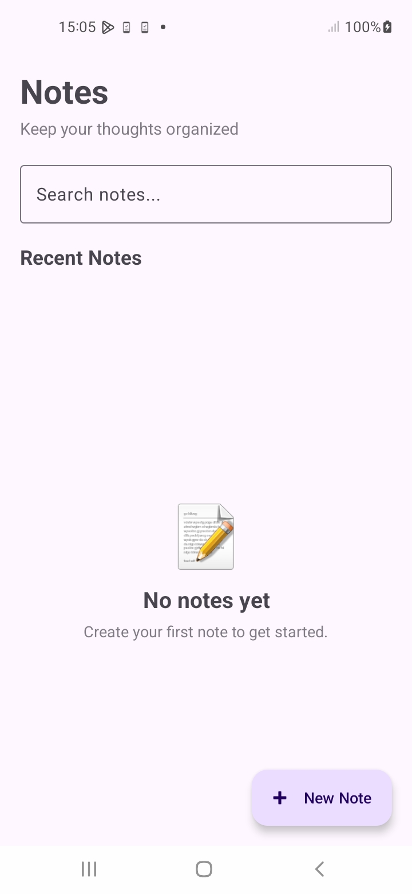
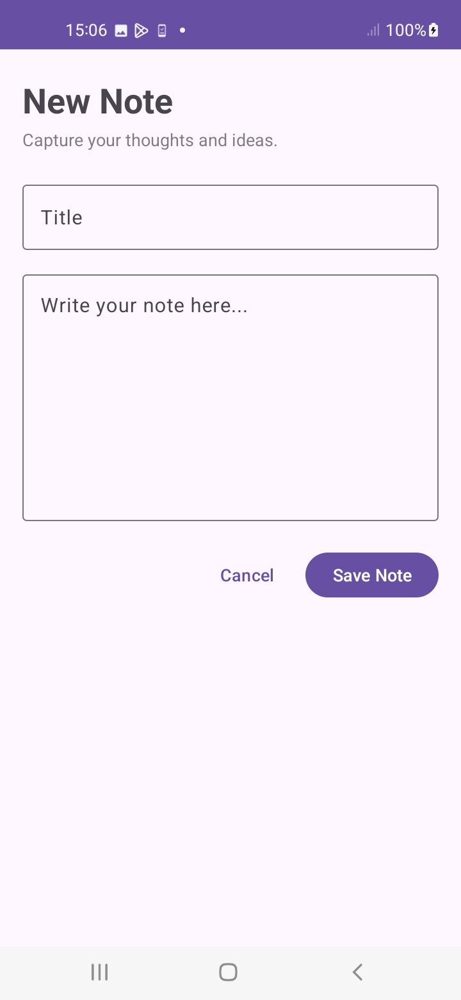
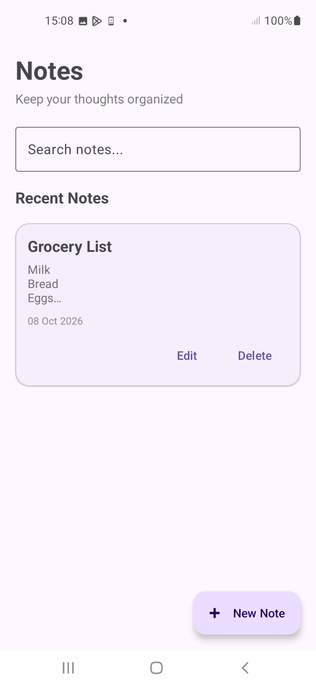
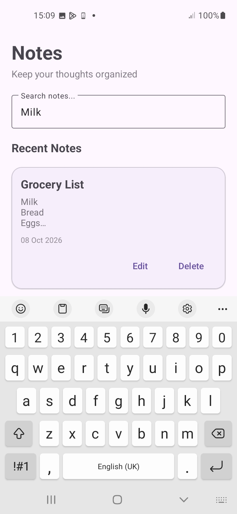
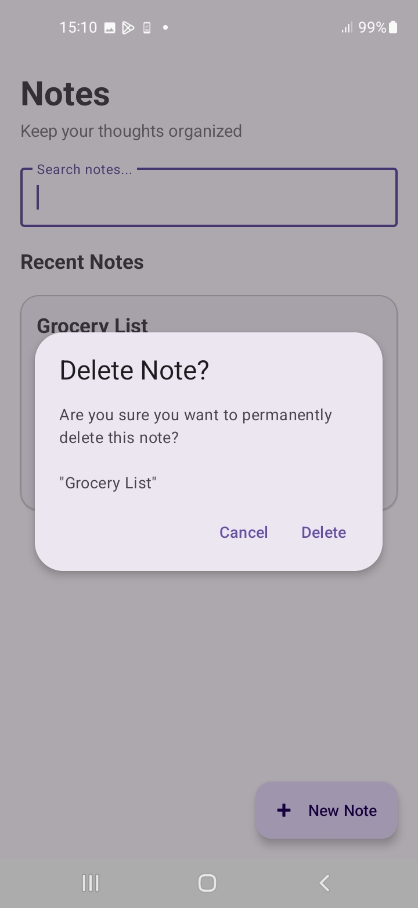
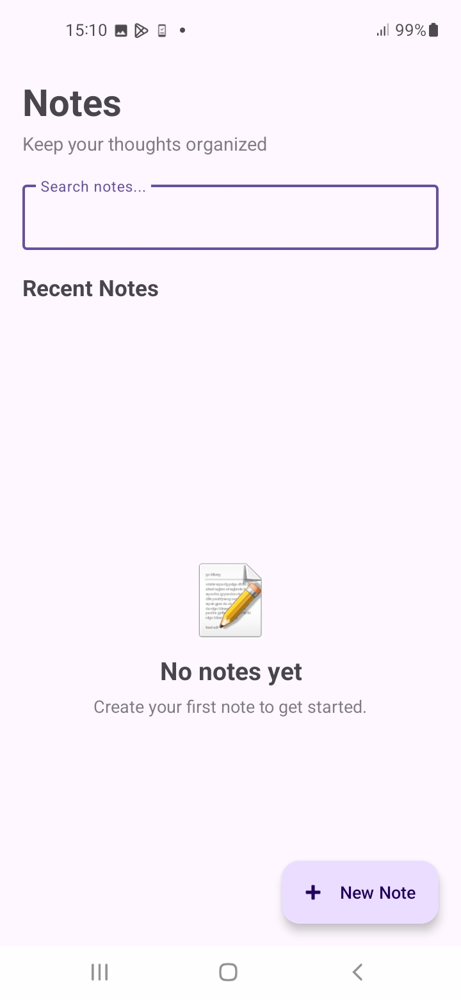

# Notes Management App

A beginner-friendly Android application for creating, organizing, editing, deleting, and searching personal notes.

This project was developed as part of the **Auspify Technologies Android Developer Internship — Task 4: Notes Management App**.

## Project Overview

The Notes Management App allows users to create and manage personal notes locally on their Android device.

The application provides:

- Note creation
- Note viewing
- Note editing
- Note deletion
- Note searching
- Local data persistence
- Empty states
- Delete confirmation
- Input validation
- Responsive scrolling
- Search results feedback

## Internship Task Requirements

The official Task 4 requirements include:

- Design note creation and viewing screens
- Implement local data storage
- Add create, edit, and delete note functionality
- Implement search functionality
- Test data persistence and usability

The implementation in this project addresses these requirements.

## Features

### Create Notes

Users can create notes with:

- Title
- Content

The application validates the input and prevents completely empty notes from being saved.

### View Notes

Saved notes are displayed in a scrollable list showing:

- Title
- Content preview
- Last updated date
- Edit action
- Delete action

### Edit Notes

Users can open an existing note, modify its title or content, and save the changes.

The original note ID and creation time are preserved while the update timestamp is refreshed.

### Delete Notes

Users can delete notes through a confirmation dialog to help prevent accidental deletion.

### Search Notes

Users can search notes by:

- Title
- Content

Search results update while the user types.

Partial-word searches and different capitalization styles are supported by the database query.

### Empty State

When no notes exist, the application displays an empty-state message encouraging the user to create their first note.

When a search returns no matches, the application displays a separate search-specific empty state.

### Persistence

Notes are stored locally using Room Database and remain available after restarting the application.

## Technologies Used

- Kotlin
- Android Studio
- Android Views
- Material Design Components
- Room Database
- RecyclerView
- View Binding
- Kotlin Coroutines
- StateFlow
- ViewModel
- Repository Pattern
- SQLite

## Architecture

The application uses a layered architecture inspired by the MVVM pattern.

```text
User Interface
      ↓
MainActivity / NoteEditorActivity
      ↓
NotesViewModel
      ↓
NoteRepository
      ↓
NoteDao
      ↓
Room Database
      ↓
SQLite
```

## Application Data Flow

### Creating a Note

```text
Note Editor
    ↓
Input Validation
    ↓
NotesViewModel
    ↓
NoteRepository
    ↓
NoteDao
    ↓
Room
    ↓
SQLite
    ↓
Flow<List<Note>>
    ↓
RecyclerView
```

### Editing a Note

```text
Note Card
    ↓
Edit
    ↓
Note Editor
    ↓
Existing Note Data
    ↓
NotesViewModel
    ↓
NoteRepository
    ↓
NoteDao
    ↓
Room UPDATE
    ↓
Updated Note List
```

### Deleting a Note

```text
Note Card
    ↓
Delete
    ↓
Confirmation Dialog
    ↓
NotesViewModel
    ↓
NoteRepository
    ↓
NoteDao
    ↓
Room DELETE
    ↓
Updated Note List
```

### Searching Notes

```text
Search Field
    ↓
TextWatcher
    ↓
NotesViewModel
    ↓
NoteRepository
    ↓
NoteDao
    ↓
Room Search Query
    ↓
Matching Notes
    ↓
RecyclerView
```

## Main Project Structure

```text
com.example.notesmanagement
│
├── MainActivity.kt
│
├── data
│   ├── Note.kt
│   ├── NoteDao.kt
│   ├── NoteDatabase.kt
│   └── NoteRepository.kt
│
└── ui
    ├── NoteAdapter.kt
    ├── NoteEditorActivity.kt
    ├── NotesViewModel.kt
    └── NotesViewModelFactory.kt
```

## Database Design

The application uses Room Database for local storage.

### Note Entity

Each note contains:

```text
id
title
content
createdAt
updatedAt
```

The `id` is an automatically generated primary key.

The application stores creation and update timestamps as `Long` values, allowing notes to be sorted by their most recently updated time.

## Room Database Components

The Room database layer consists of three main components:

### Entity

`Note.kt` defines the structure of the `notes` database table.

### DAO

`NoteDao.kt` defines the database operations for:

- Insert
- Select
- Update
- Delete
- Search

### Database

`NoteDatabase.kt` connects the `Note` entity and `NoteDao` and provides the application's Room database instance.

## Search Implementation

The search feature checks both the note title and note content.

The database query conceptually works like:

```sql
SELECT *
FROM notes
WHERE title LIKE '%' || :searchQuery || '%'
   OR content LIKE '%' || :searchQuery || '%'
ORDER BY updated_at DESC, id DESC
```

This allows users to find notes even when the search term appears only inside the note content.

Search results update as the user types.

## UI States

The application supports different interface states depending on the current data and operation.

### Normal State

Displays all saved notes.

### Loading State

Displays a progress indicator while note data is being observed.

### Empty State

Displayed when there are no saved notes.

### Search Empty State

Displayed when a search query returns no matching notes.

### Error State

Displays a user-friendly message when a database operation encounters an error.

## Validation and Error Handling

The application validates note input before saving.

For example:

```text
Empty title + Empty content
        ↓
"Please enter a title or note content."
```

The editor remains open so that the user can correct the input.

Deletion also requires confirmation before the database operation is performed.

Database errors are handled through the ViewModel and exposed to the UI as user-facing messages instead of exposing technical exceptions directly to the user.

## RecyclerView Implementation

The application uses RecyclerView and ListAdapter to display notes efficiently.

Each note item displays:

- Title
- Content preview
- Last updated date
- Edit button
- Delete button

`DiffUtil` is used to determine which notes have changed so that the RecyclerView can update efficiently.

## Testing

The application was tested on a physical Android device.

### Create Tests

- Open New Note screen
- Empty-note validation
- Create note
- Persistence after application restart

### Edit Tests

- Open existing note
- Edit title and content
- Verify no duplicate is created
- Cancel edit
- Edit content only

### Delete Tests

- Cancel deletion
- Confirm deletion
- Verify correct removal
- Persistence after deletion

### Search Tests

- Search by title
- Search by content
- Partial-word search
- No search results
- Clear search
- Live search while typing
- Case variation
- Search after editing
- Search after deleting

### Integration Tests

- Complete CRUD cycle
- Multiple-note ordering
- Search persistence
- Edit while searching
- Delete while searching
- Application restart

All completed tests passed during development.

## Screenshots

### Main Notes Screen



### New Note / Note Editor



### Notes List



### Search Results



### Delete Confirmation



### Empty State



## How to Run

1. Clone the repository.
2. Open the project in Android Studio.
3. Allow Gradle synchronization to complete.
4. Build the project.
5. Connect an Android device or start an Android emulator.
6. Run the application.

No external internet connection is required for the core note-management functionality because notes are stored locally on the device.

## Project Configuration

```text
Package:
com.example.notesmanagement

Minimum SDK:
24

Target SDK:
37

Compile SDK:
37

Java:
11
```

## Data Storage

Notes are stored locally using **Room Database**, which uses SQLite as the underlying database engine.

The application does not require a remote backend for the core note-management features.

## Author

**Patrick Morrison**

Android Developer Intern

## Internship

This project was developed as part of the:

**Auspify Technologies — Android Developer Internship**

### Task

**Task 4 — Notes Management App**

## Project Status

**Completed**

The application has been functionally tested on a physical Android device, including:

- Create operations
- Read/display operations
- Edit operations
- Delete operations
- Search functionality
- Input validation
- Empty states
- Persistence
- Integration scenarios

All completed functional and integration tests passed during development.